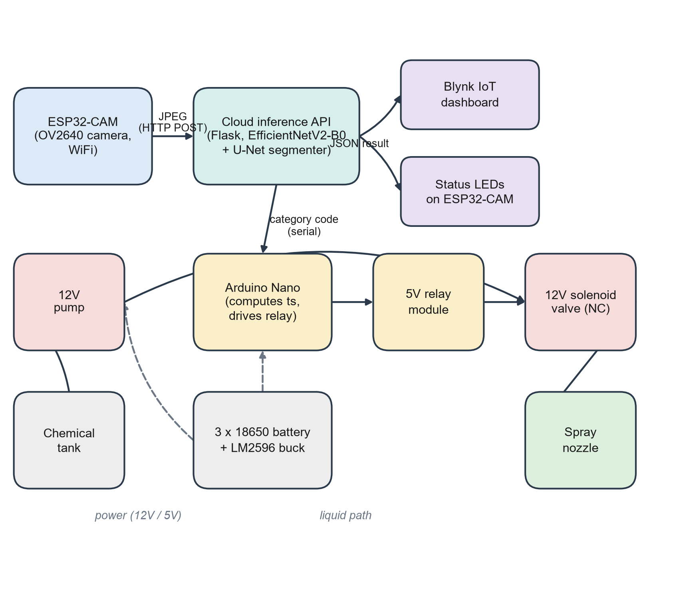
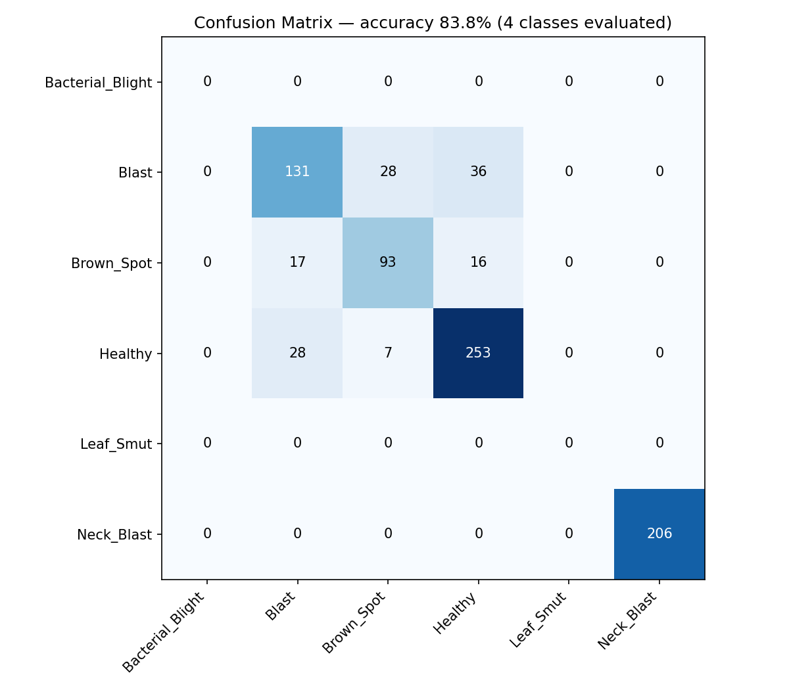
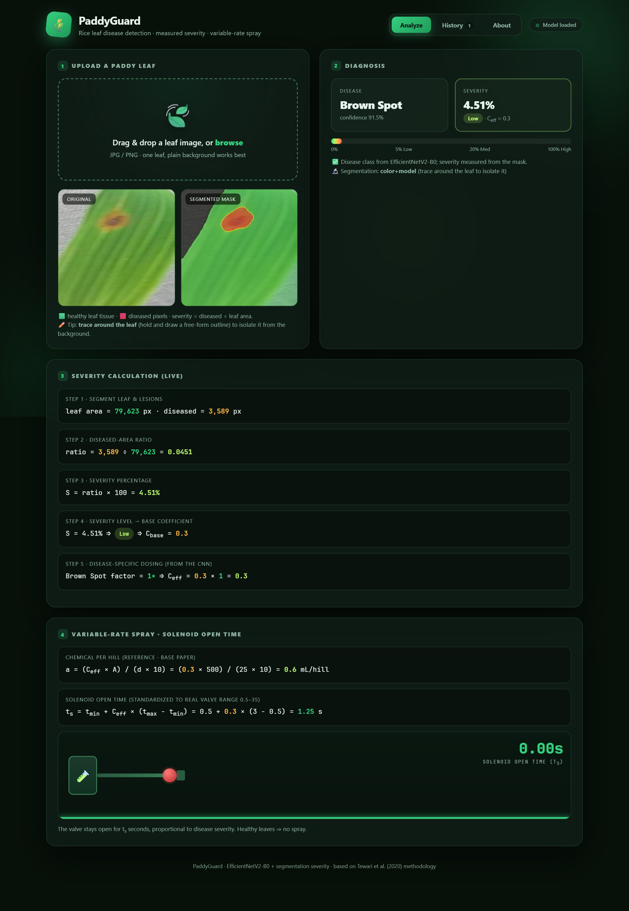

# PaddyGuard: Variable-Rate Sprayer for Rice Leaf Disease

Deep learning and IoT based variable-rate chemical spraying for disease control
in paddy (rice) crops. A camera image of a rice leaf is classified for disease,
the diseased area is measured by segmentation, and the measured severity sets
how long a solenoid valve stays open, so healthy plants get no chemical and
heavily infected plants get more.

Capstone project BCE497J / BCSE497J, SCOPE, VIT Chennai. Authors: Sourish Das
(23BCE1179) and Aditya Singh (23BCE1293). Guide: Dr. Vergin Raja Sarobin M.

## Contents

- [How it works](#how-it-works)
- [Results](#results)
- [Repository layout](#repository-layout)
- [Quick start](#quick-start)
- [Hardware](#hardware)
- [Rebuilding the report](#rebuilding-the-report)
- [Project status and limitations](#project-status-and-limitations)
- [Datasets and references](#datasets-and-references)
- [Credentials and secrets](#credentials-and-secrets)
- [License](#license)

## How it works

```
ESP32-CAM  --RGB565 frame-->  Flask API (/predict)  --JSON-->  ESP32-CAM  --"S<ms>,<cat>"-->  Arduino Nano  -->  relay  -->  solenoid valve
                              1. EfficientNetV2-B0 classifies the disease
                              2. U-Net (optionally with MobileSAM leaf isolation) segments the lesions
                              3. severity % = 100 * diseased pixels / leaf pixels
                              4. severity level and disease factor give the dose and valve open time
```



| Severity % | Level | Base coefficient |
|------------|-------|------------------|
| Healthy (or below 1.5%) | Healthy | 0.00 |
| 0.1 - 5 | Low | 0.30 |
| 5.1 - 20 | Medium | 0.55 |
| above 20 | High | 0.80 |

The base coefficient is multiplied by a per-disease factor (Bacterial Blight
1.20, Neck Blast 1.25, Blast 1.15, Brown Spot 1.00, Leaf Smut 0.80). The valve
open time is limited to a 0.5 to 3.0 s window. Classes: `Bacterial_Blight`,
`Blast`, `Brown_Spot`, `Healthy`, `Leaf_Smut`, `Neck_Blast`. Details are in
[results/RESULTS.md](results/RESULTS.md) and
[docs/model_run_instructions.md](docs/model_run_instructions.md).

## Results

Measured on held-out validation data (see [results/RESULTS.md](results/RESULTS.md)):

| Component | Metric | Value |
|-----------|--------|-------|
| 6-class classifier (merged datasets) | Validation accuracy (815 images) | 83.80% |
| 3-class classifier (UCI paddy set) | Test accuracy (164 images) | 91.5% |
| Lesion segmenter (U-Net, PlantSeg) | Validation IoU / Dice (1,247 images) | 0.4450 / 0.5641 |
| Software tests | Unit tests / API tests | 37 of 37 / 13 of 13 passed |



Bacterial Blight and Leaf Smut have only 55 training images each, so they are
the weakest classes. Blast and Brown Spot are often confused with each other.



## Repository layout

```
.
├── app/            Flask server and PaddyGuard web UI            -> app/README.md
├── model/          Inference code, training scripts, weights (LFS) -> model/README.md
├── notebooks/      Colab training notebooks                       -> notebooks/README.md
├── firmware/       ESP32-CAM and Arduino Nano sketches, Blynk     -> firmware/README.md
├── hardware/       Build plan, bill of materials, bench test log   -> hardware/README.md
├── data/           Sample leaf images for testing                  -> data/README.md
├── docs/           Run guide for training, prediction and demo     -> docs/README.md
├── results/        Metrics, charts, review presentations           -> results/README.md
├── report/         Final report sources, figures, built reports    -> report/README.md
├── scripts/        Helper scripts (chart generation)               -> scripts/README.md
├── LICENSE
└── README.md
```

## Quick start

Requirements: Python 3.11, [Git LFS](https://git-lfs.com) (the trained models
are stored with LFS).

```bash
git clone https://github.com/SourishOP/Variable-rate-sprayer.git
cd Variable-rate-sprayer
git lfs pull                       # downloads the .keras and .pt model files
```

Create a virtual environment and install the app dependencies.

Windows (PowerShell):

```powershell
python -m venv .venv
.venv\Scripts\Activate.ps1
pip install -r app/requirements.txt
```

Linux / macOS:

```bash
python3 -m venv .venv
source .venv/bin/activate
pip install -r app/requirements.txt
```

Run the web demo and open <http://127.0.0.1:5000>:

```bash
python app/server.py
```

Predict on one image from the command line:

```bash
python model/predict.py --image data/sample_images/Brown_Spot/Brown_Spot_01.jpg
```

Without a model file the server starts in demo mode (heuristic disease label,
but severity is still measured from the mask). To train the models, open the
notebooks in [notebooks/](notebooks/README.md) on Google Colab with a GPU.

## Hardware

AI-Thinker ESP32-CAM (capture and Wi-Fi), Arduino Nano (valve timing), 5 V
relay module, 12 V normally-closed solenoid valve, 12 V diaphragm pump, LM2596
buck converter, spray nozzle and silicone tubing. Planned budget is about
Rs. 2,250 to 2,400. The wiring, build phases and bill of materials are in
[hardware/hardware_implementation_plan.md](hardware/hardware_implementation_plan.md).
To flash the boards, copy `firmware/esp32cam_sprayer/secrets.h.example` to
`secrets.h`, fill it in, and follow [firmware/README.md](firmware/README.md).

## Rebuilding the report

The report is generated from Markdown sources by Python scripts. See
[report/README.md](report/README.md). Built copies (DOCX and PDF) are in
`report/output/`.

## Project status and limitations

- The software chain (classifier, segmenter, severity, dosing, web UI, Flask
  API) is complete and tested.
- On hardware, the ESP32-CAM and Arduino Nano are flashed and bench tested on USB
  power, including a dry run of the relay and valve. The full liquid path with
  the pump and a battery powered run were not done. The pump flow rate Qs is the
  design value of 3.5 mL/s, not a measured one. See
  [hardware/HARDWARE_TEST_DATA.md](hardware/HARDWARE_TEST_DATA.md) and
  [report/OPEN_ITEMS.md](report/OPEN_ITEMS.md).
- Bacterial Blight and Leaf Smut need more training data.
- The 0.5 to 3.0 s spray window is a research-based default, not calibrated to
  a specific pump and nozzle.

## Datasets and references

- Paddy Leaf Disease (UCI), Kaggle `badhon7432/paddyleafdiseaseuci`.
- An open HuggingFace rice leaf set, merged in for Healthy, Blast and Neck Blast
  (see `model/colab_train_merged.py`).
- PlantSeg (Wei et al., 2024), Zenodo record
  [14935094](https://zenodo.org/records/14935094), used for lesion
  segmentation. Check its license terms before reuse.
- Base paper: Tewari et al. (2020), *Image processing based real-time
  variable-rate chemical spraying system for disease control in paddy crop*,
  Artificial Intelligence in Agriculture, 4, 21-30.
- MobileSAM, run through the `ultralytics` package.

The full reference list is in [report/content/references.json](report/content/references.json).
The images in `data/sample_images/` come from the public datasets above and
keep their original licenses.

## Credentials and secrets

No credentials are stored in this repository. Wi-Fi, server URL and Blynk
values go in `firmware/esp32cam_sprayer/secrets.h` (git-ignored), and Kaggle
tokens go in an environment variable (`KAGGLE_API_TOKEN`).

## License

Code is released under the [MIT License](LICENSE). Datasets, papers and model
backbones keep their own licenses.
